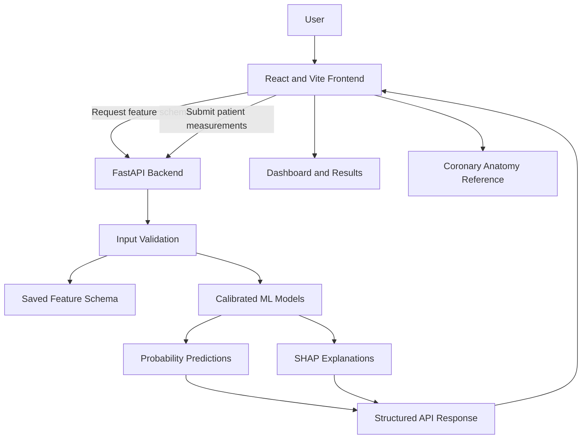

# CardioAI: Explainable Cardiovascular Risk Assessment

CardioAI is a web-based cardiovascular risk assessment prototype that combines a React frontend, a FastAPI backend, and machine-learning models to present coronary artery disease (CAD) and vessel-level risk predictions with patient-level explanations.

The project is designed to demonstrate an end-to-end AI workflow: collecting structured patient measurements, validating inputs, generating model predictions, explaining contributing features, and presenting results through a web interface.

> **Important medical disclaimer:** CardioAI is an educational and research prototype. Its predictions and explanations are not a diagnosis, do not replace professional medical judgment or diagnostic imaging, and are not validated for clinical decision-making. Vessel-level probabilities do not anatomically locate plaque or lesions. The displayed `LOW`, `MODERATE`, and `HIGH` bands are prototype visualization categories, not validated clinical risk categories.

## Table of Contents

- [Project Overview](#project-overview)
- [Key Features](#key-features)
- [System Architecture](#system-architecture)
- [Frontend](#frontend)
- [Backend and API](#backend-and-api)
- [Machine Learning Pipeline](#machine-learning-pipeline)
- [Dataset and Prediction Targets](#dataset-and-prediction-targets)
- [Model Evaluation](#model-evaluation)
- [Explainability](#explainability)
- [Repository Structure](#repository-structure)
- [Requirements](#requirements)
- [Local Setup](#local-setup)
- [Running the Application](#running-the-application)
- [API Contract](#api-contract)
- [Configuration and Model Artifacts](#configuration-and-model-artifacts)
- [Testing and Validation](#testing-and-validation)
- [Deployment Status](#deployment-status)
- [Limitations and Future Improvements](#limitations-and-future-improvements)
- [Disclaimer](#disclaimer)

## Project Overview

CardioAI explores how machine learning and explainable AI can be combined with a web interface to make cardiovascular risk assessment outputs easier to inspect and understand.

The application has three principal components:

1. **Frontend:** A browser-based dashboard for presenting patient inputs, assessment outputs, and a coronary artery anatomy reference.
2. **Backend:** A Python FastAPI service that validates inputs, loads trained model artifacts, generates predictions, and returns explanations.
3. **Machine learning:** Separate trained models for CAD and three coronary artery targets, with calibrated probability outputs and SHAP-based feature explanations.

The frontend and backend are developed as separate components. The backend API is responsible for inference; the frontend is responsible for collecting and displaying information.

## Key Features

- Interactive cardiovascular assessment dashboard.
- Structured patient measurement inputs.
- Feature schema describing expected inputs, types, defaults, and permitted categorical values.
- Machine-learning probability predictions for CAD, LAD, LCX, and RCA targets.
- Prototype risk display bands based on configured thresholds.
- Patient-level SHAP explanations showing features that contribute to model outputs.
- Coronary artery anatomy reference for the LAD, LCX, and RCA.
- Request validation to reject missing, extra, invalid, or out-of-range input values.
- API health and schema endpoints.
- Automated tests for data handling, validation, and prediction behavior.

The anatomy visualization is a reference only. The model does not identify a patient's plaque location or establish anatomical lesion localization.

## System Architecture



### Prediction workflow

1. The frontend requests the available input schema from `GET /schema`.
2. The user supplies patient measurements through the interface.
3. The frontend submits the measurements to `POST /predict`.
4. FastAPI validates the payload against the saved feature schema.
5. The backend prepares the input and passes it to the trained model pipelines.
6. The models generate probability predictions for the supported targets.
7. SHAP-based explanations identify important feature contributions to the predictions.
8. The backend returns predictions, explanations, measurements, and an anatomical-localization flag.
9. The frontend displays the returned results.

The workflow above describes the intended integrated application. Live end-to-end behavior depends on the frontend being connected to a running, correctly configured backend.

## Frontend

The frontend is built with **React and Vite** and provides the browser-based interface for CardioAI.

Its responsibilities include:

- Presenting the main dashboard.
- Collecting patient measurements.
- Retrieving the expected feature schema from the backend.
- Sending patient inputs to the prediction endpoint.
- Displaying prediction results and feature explanations when the API returns them.
- Showing a coronary artery anatomy reference for the LAD, LCX, and RCA.

The frontend is deployed separately from the Python backend.

**Frontend URL:** https://cardio-ai-eight.vercel.app

The deployed website's interface can be accessed independently. Live predictions require a reachable and compatible backend; the existence of a deployed frontend alone does not establish that inference is working.

### Frontend development

From the repository root:

```powershell
cd frontend
npm install
npm run dev
```

Vite prints the local development URL in the terminal, commonly `http://localhost:5173`.

To create a production frontend build:

```powershell
npm run build
```

To preview a production build locally:

```powershell
npm run preview
```

The frontend API base URL should be configured for the environment in which the application runs. If `VITE_API_BASE_URL` is used by the frontend code, set it to the base URL of the running backend, without adding the endpoint path twice.

For example, a local backend base URL is:

```text
http://127.0.0.1:8000
```

A public backend URL must be supplied after a backend service has been successfully deployed and tested.

Vite environment variables prefixed with `VITE_` are exposed to browser code. Do not place secrets or private credentials in them.

## Backend and API

The backend is built with **FastAPI**, with Pydantic used for request and response validation.

Its main responsibilities are:

- Serving API health information.
- Providing the saved inference feature schema.
- Validating submitted patient measurements.
- Loading the trained model and supporting artifacts.
- Generating prediction probabilities.
- Calculating SHAP-based patient-level explanations.
- Returning structured results to the frontend.
- Applying configured CORS rules to frontend origins.

### API endpoints

| Method | Endpoint | Purpose |
|---|---|---|
| `GET` | `/health` | Checks whether the API is responding without loading model artifacts. |
| `GET` | `/schema` | Returns the inference feature schema and input metadata. |
| `POST` | `/predict` | Validates patient inputs and returns predictions and explanations. |
| `GET` | `/docs` | Opens FastAPI's interactive Swagger documentation. |

The `/health` endpoint returns:

```json
{
  "status": "ok"
}
```

A successful health response indicates that the API is responding. It does not, by itself, prove that all model artifacts are available or that inference will succeed.

## Machine Learning Pipeline

CardioAI trains and evaluates separate binary classifiers for four targets:

- CAD
- LAD
- LCX
- RCA

The training workflow compares Logistic Regression, Random Forest, and XGBoost using nested stratified cross-validation.

### Training and model selection

The pipeline follows these steps:

1. Load and validate the source dataset.
2. Exclude target and leakage columns from each task's feature matrix.
3. Keep preprocessing within the model pipeline.
4. Compare candidate algorithms using nested stratified cross-validation.
5. Perform algorithm selection using only each outer training fold, with four-fold inner cross-validation.
6. Calibrate the selected model using only the corresponding outer training data.
7. Evaluate the calibrated model once on the untouched outer test fold.
8. After nested evaluation, use a separate four-fold cross-validation over all development records to select the deployment algorithm.
9. Fit the final calibrated deployment model using all development records.

The reported nested outer-fold scores estimate performance on held-out portions of this dataset. The final deployment model is trained on all development records and is not independently evaluated by those same outer-fold scores.

Logistic Regression and Random Forest use built-in class weighting. XGBoost is unweighted.

### Probability predictions and display bands

The backend returns probability predictions for the supported targets. Configured thresholds are used to assign the prototype display bands `LOW`, `MODERATE`, and `HIGH`.

These bands are intended for application visualization only. They are not validated clinical risk categories, and their thresholds should not be interpreted as medically established cutoffs.

## Dataset and Prediction Targets

The source workbook is:

```text
data/raw/extention of Z-Alizadeh sani dataset.xlsx
```

The raw source file is excluded from Git.

The loader reads `Sheet 1 - Table 1` and validates the inspected dataset's 303 rows, 59 columns, and required outcome labels. The other sheet contains no records.

Raw categorical values are preserved as supplied, including:

- `Sex`: `Fmale`
- `Obesity`: `Y` and `N`

`Exertional CP` is constant in the inspected data and is excluded from the model features.

### Binary prediction tasks

| API/model key | Source column | Positive label |
|---|---|---|
| `cad` | `Cath` | `CAD` |
| `lad` | `LAD` | `Stenotic` |
| `lcx` | `LCX` | `Stenotic` |
| `rca` | `RCA` | `Stenotic` |

`LAD`, `LCX`, `RCA`, and `Cath` are excluded from every task's feature matrix. The constant feature `Exertional CP` is also excluded.

Numeric codes are retained as numeric observations. The implementation does not assign undocumented meanings to those codes.

## Model Evaluation

The following values are the reported nested outer-fold results across five folds, expressed as mean ± standard deviation.

| Target | Selected deployment model | Accuracy | Precision | Recall | F1 | ROC-AUC | Brier |
|---|---|---:|---:|---:|---:|---:|---:|
| CAD | Random Forest | 0.844 ± 0.065 | 0.875 ± 0.060 | 0.917 ± 0.056 | 0.894 ± 0.043 | 0.919 ± 0.054 | 0.107 ± 0.041 |
| LAD | Random Forest | 0.792 ± 0.059 | 0.790 ± 0.052 | 0.882 ± 0.053 | 0.833 ± 0.045 | 0.857 ± 0.061 | 0.153 ± 0.029 |
| LCX | XGBoost | 0.693 ± 0.064 | 0.650 ± 0.131 | 0.504 ± 0.060 | 0.565 ± 0.079 | 0.729 ± 0.075 | 0.205 ± 0.020 |
| RCA | Random Forest | 0.657 ± 0.026 | 0.569 ± 0.033 | 0.369 ± 0.161 | 0.430 ± 0.130 | 0.691 ± 0.017 | 0.213 ± 0.006 |

These results are internal cross-validation estimates from 303 records. They are not external validation, evidence of clinical effectiveness, or a guarantee of performance on new populations.

Performance varies by target. In particular, the LCX and RCA results indicate limitations that should be considered when interpreting those outputs.

### Threshold methodology

Outer-fold display thresholds are estimated using only the corresponding outer training split. Deployment thresholds are separately derived from the final development-data fit and do not affect the reported nested evaluation scores.

## Explainability

CardioAI uses SHAP-based explanations to summarize which input features contribute to individual model predictions.

The backend uses the saved background feature dataset and the relevant trained model to calculate patient-level feature contributions. The API returns the leading contributions for display alongside the prediction results.

The explanations are intended to make model behavior more inspectable. They do not establish causation, prove a medical mechanism, or replace clinical interpretation.

The implementation supports feature-level explanations. It does **not** perform anatomical localization of coronary lesions.

## Repository Structure

The project includes the following main components:

```text
Cardio-AI/
├── backend/
│   ├── main.py
│   └── config.py
├── frontend/
│   ├── public/
│   │   └── models/
│   └── ...
├── ml/
│   ├── constants.py
│   ├── explain.py
│   ├── eda.py
│   └── train.py
├── models/
│   ├── inference_schema.json
│   ├── background_features.joblib
│   ├── cad_model.joblib
│   ├── lad_model.joblib
│   ├── lcx_model.joblib
│   ├── rca_model.joblib
│   └── risk_thresholds.json
├── data/
│   └── raw/
├── docs/
│   ├── api_contract.md
│   └── validation.md
├── tests/
├── requirements.txt
├── pytest.ini
└── README.md
```

This tree is representative of the project's main components; some files and folders may differ in a particular checkout.

The model directory contains the saved inference artifacts. The frontend's `public/models/` directory contains the assets used for the browser-based anatomy reference; these visual assets are separate from the backend's trained machine-learning models.

## Requirements

Use Python 3.12 for the backend and ML workflow.

The pinned Python dependencies are specified in `requirements.txt`. They include:

- FastAPI and Pydantic for the API.
- pandas and NumPy for structured data handling.
- scikit-learn and XGBoost for machine learning.
- SHAP for explanations.
- joblib for model artifact loading.
- Supporting packages for training, evaluation, testing, and data handling.

The frontend uses Node.js and npm. Frontend dependencies are managed in the `frontend/` directory.

## Local Setup

### 1. Create and activate the Python environment

From the repository root in PowerShell:

```powershell
py -3.12 -m venv .venv
.\.venv\Scripts\Activate.ps1
python -m pip install --upgrade pip
python -m pip install -r requirements.txt
```

### 2. Run exploratory data analysis

```powershell
python -m ml.eda
```

This command depends on the source workbook being available at the expected path.

### 3. Train the models

```powershell
python -m ml.train
```

Training runs the configured model comparison, cross-validation, calibration, final model selection, and artifact-generation workflow. It can take time because nested cross-validation is computationally more expensive than a single train/test split.

### 4. Run the backend

From the repository root:

```powershell
python -m uvicorn backend.main:app --reload --host 127.0.0.1 --port 8000
```

Open the interactive API documentation at:

```text
http://127.0.0.1:8000/docs
```

Check the health endpoint:

```text
http://127.0.0.1:8000/health
```

Check the feature schema:

```text
http://127.0.0.1:8000/schema
```

### 5. Run the frontend

Open a second terminal:

```powershell
cd frontend
npm install
npm run dev
```

Use the local URL printed by Vite. If the frontend requires a configured API base URL, set it to:

```text
http://127.0.0.1:8000
```

The browser must be able to reach the API, and the backend's CORS configuration must allow the frontend's exact origin.

### 6. Run the tests

From the repository root:

```powershell
pytest -q -m "not integration"
```

To run the full test suite:

```powershell
pytest -q
```

Integration tests may require the source dataset, generated artifacts, or additional setup described by the tests.

### 7. Run the explanation workflow

```powershell
python -m ml.explain
```

This command depends on the saved model and background artifacts required by the explanation implementation.

## API Contract

### `GET /health`

Checks whether the API process is responding. This endpoint does not load the source workbook or model artifacts.

Example response:

```json
{
  "status": "ok"
}
```

### `GET /schema`

Returns the inference schema, including feature names, display names, types, allowed categorical values, observed numeric ranges, and defaults.

Target/leakage fields and the constant feature are excluded.

### `POST /predict`

Accepts one flat JSON object containing every feature returned by `/schema`.

The request validator rejects:

- Missing required fields.
- Extra fields.
- Unobserved categorical labels.
- Incorrect data types.
- Numeric values outside the observed training range.

The response contains:

- `predictions`: probability predictions and prototype display bands for the supported targets.
- `explanations`: leading patient-level SHAP contributions.
- `measurements`: the submitted values.
- `anatomical_localization`: `false`.

See [`docs/api_contract.md`](docs/api_contract.md) for the detailed contract, including a synthetic sample request and matching response.

### Constructing an example payload

The following snippet constructs a payload from a real source row while excluding outcome and leakage columns. It is for local development and testing only; the source workbook must be present.

```python
import pandas as pd

row = pd.read_excel(
    "data/raw/extention of Z-Alizadeh sani dataset.xlsx",
    sheet_name="Sheet 1 - Table 1",
).iloc[0]

forbidden = {"LAD", "LCX", "RCA", "Cath", "Exertional CP"}
payload = {
    key: value
    for key, value in row.items()
    if key not in forbidden
}
```

For a request that passes API validation, the payload must contain the complete feature set returned by `/schema` and use the expected JSON-compatible values.

## Configuration and Model Artifacts

The backend uses these saved artifacts:

- `inference_schema.json`
- `background_features.joblib`
- `cad_model.joblib`
- `lad_model.joblib`
- `lcx_model.joblib`
- `rca_model.joblib`
- `risk_thresholds.json`

The backend configuration supports:

- `CARDIO_AI_ARTIFACT_DIR`: path to the directory containing the required model artifacts.
- `CARDIO_AI_CORS_ORIGINS`: comma-separated list of allowed frontend origins.

The default CORS origins are:

```text
http://localhost:5173
http://127.0.0.1:5173
```

Production deployment should configure the exact origin of the deployed frontend. Wildcard CORS is disabled in the documented configuration.

The source workbook is needed for the documented training and exploratory-analysis workflows. API startup and inference use the saved model artifacts and do not read the workbook.

Preprocessing is embedded in each calibrated model artifact; no separate preprocessing artifact is used.

## Testing and Validation

The tests cover:

- Dataset shape and required outcome labels.
- Preservation of observed categorical values.
- Exclusion of forbidden target and leakage columns.
- Request validation.
- Health and schema endpoints.
- Deterministic repeated predictions.

See [`docs/validation.md`](docs/validation.md) for further information about the validation workflow, small-dataset limitations, and interpretation of the reported metrics.

## Deployment Status

The frontend is deployed at:

**https://cardio-ai-eight.vercel.app**

The FastAPI backend has been developed separately. During deployment attempts, Vercel reported that the packaged Python function exceeded its 500 MB limit, so the backend has not yet been confirmed as successfully deployed and connected to the public frontend.

Consequently, the public frontend should not be described as providing working live inference until all of the following have been verified:

1. The backend is reachable at its deployed URL.
2. `GET /health` responds successfully.
3. `GET /schema` returns the expected feature schema.
4. `POST /predict` returns a valid prediction and explanation response.
5. The deployed frontend can call the backend without network or CORS errors.

For local development, the backend can be run using the instructions in [Local Setup](#local-setup).

## Limitations and Future Improvements

Current limitations include:

- A small dataset of 303 records.
- No external validation or evidence of clinical utility.
- Variable performance across prediction targets.
- Potential differences between the source population and future users.
- Numeric codes retained as numeric observations without undocumented semantic interpretation.
- Prototype display thresholds that are not validated clinical cutoffs.
- No anatomical lesion localization.
- Public frontend availability without confirmed live backend inference until deployment is completed.

Potential future improvements include:

- External validation on larger and more diverse datasets.
- More rigorous calibration and threshold evaluation.
- Clinical review and appropriate governance before any clinical use.
- Improved monitoring, error reporting, and deployment reliability.
- Verification of end-to-end frontend/backend connectivity.
- Clearer presentation of model uncertainty and limitations.

## Disclaimer

CardioAI is an educational and research prototype intended to demonstrate machine learning, API engineering, and explainable AI. It is not a medical device and is not intended to diagnose, treat, or prevent any disease. Model predictions, probability values, SHAP contributions, and display bands must not be used as substitutes for qualified clinical judgment, diagnostic imaging, or appropriate medical care.
